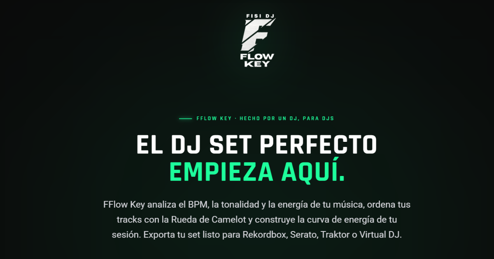
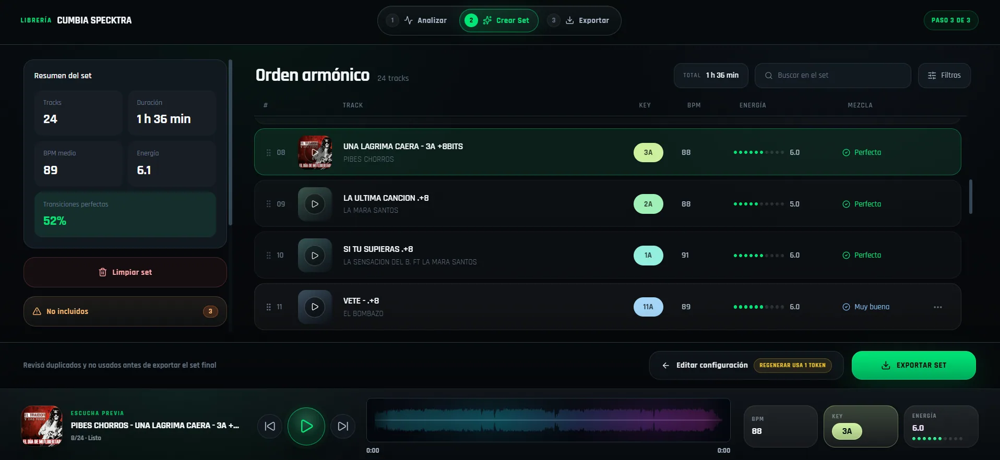
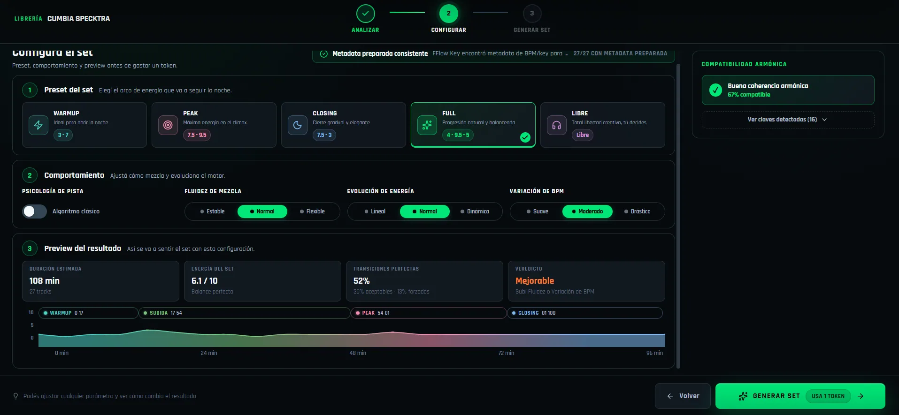
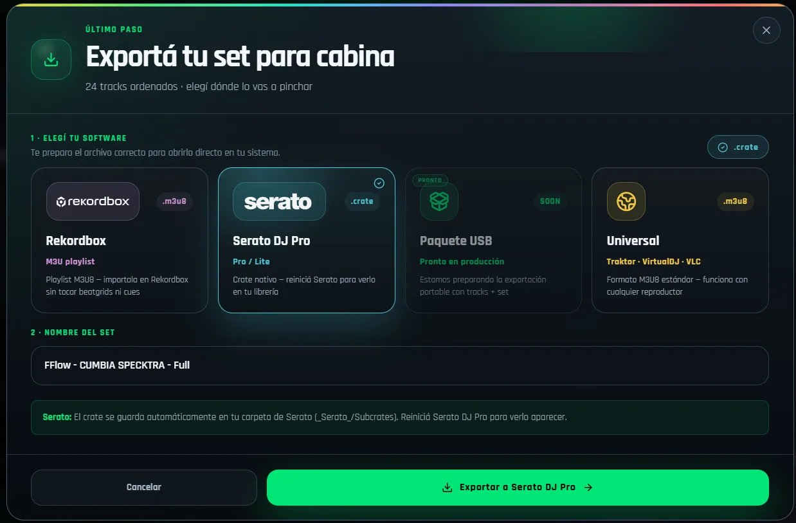

  
  <h1>FFlow Key</h1>
  
<strong>De tu biblioteca a tu próximo set.</strong>

  
Analiza tu música. Diseña el recorrido. Continúa en tu software DJ favorito.

  

    
    
    
  

  

    
    
  

  
<a href="https://fisidj.com/fflow-key/">Conoce el producto</a> · <a href="https://github.com/fisidj/fflow-key-releases/releases/latest">Novedades y archivos</a> · <a href="mailto:fisidjnetwork@gmail.com">Contacto</a>

---

**FFlow Key se integra en tu workflow de DJ.** Combina su propio motor de análisis
con los datos disponibles de tu software habitual para ayudarte a ordenar tu
música y preparar sets por BPM, tonalidad y energía. Tú eliges la música, revisas
las transiciones y decides qué llevar a cabina.

Creado por **Jorge Avendaño — FISI Dj** para resolver un problema personal:
el tiempo que llevaba organizar su música y preparar sus sesiones. Hoy se
comparte para mejorar con la experiencia y las aportaciones de otros DJs.

> **2.2.0 · beta.** Entras con tu cuenta de Google o Microsoft y la app se
> mantiene sola en la última versión. Puede presentar fallos: el análisis es una
> ayuda para preparar el set; revisa los resultados y preescucha las transiciones.

## Novedades de la 2.2.0

- **Entras con Google o Microsoft.** La sesión se queda guardada; cambiar de cuenta es cerrar sesión y entrar con otra.
- **Hablamos de sets, no de tokens.** Ves un solo número: los sets que te quedan más los 2 gratis del mes.
- **Pro más directo.** Al terminar el pago, FFlow Key se abre y se actualiza sola.
- **Actualizaciones automáticas.** Las nuevas versiones se descargan e instalan solas al abrir la app.
- **Ventanas renovadas.** Ajustes, plan, exportar y soporte comparten diseño y se cierran con Esc; Configuración del set cabe en una sola pantalla.
- **djay Pro** como fuente de BPM y tonalidad, sin romper el análisis.

[Todas las novedades y correcciones de la versión](https://github.com/fisidj/fflow-key-releases/releases/latest).

## Qué puedes hacer

| Tu trabajo | Cómo te ayuda FFlow Key |
| --- | --- |
| Conocer tu música | Analiza BPM, tonalidad y energía en tu equipo; muestra resultados canción a canción. |
| Aprovechar lo que ya analizaste | Lee los datos de Serato, Rekordbox, VirtualDJ y djay Pro sin modificar tus bibliotecas, además de las etiquetas de Mixed In Key. Eliges las fuentes de BPM y tonalidad por separado. |
| Corregir antes de generar | Revisa el BPM junto a Configuración: escucha, edita el valor, usa ×2/÷2 o restaura el original. |
| Dar forma a la sesión | Modos Warmup, Full, Peak, Closing y Libre, con ajustes de compatibilidad armónica y evolución de energía. La curva de energía del set es lo primero que ves. |
| Afinar tu selección | Preescucha, revisión de duplicados y edición del orden del set, con el nombre de tus archivos tal cual están en tu carpeta. |
| Seguir en tu software habitual | Exporta un crate para Serato o djay Pro, o una playlist M3U8 para Rekordbox, VirtualDJ y Traktor. |
| Trabajar con más control | Validaciones de exportación, protección frente a sobrescrituras y acceso a tus últimas exportaciones desde Ajustes. |

## Una mirada al flujo de trabajo

  

<table>
  <tr>
    <td width="50%"></td>
    <td width="50%"></td>
  </tr>
  <tr>
    <td><strong>Diseña el recorrido.</strong> Ajusta el modo y el comportamiento del set.</td>
    <td><strong>Continúa en cabina.</strong> Elige el formato para tu software DJ.</td>
  </tr>
</table>

Imágenes de referencia del producto utilizadas en fisidj.com. La interfaz puede evolucionar durante la beta. Pulsa una imagen para verla a tamaño completo.

## De una carpeta a tu set

1. **Entra con tu cuenta.** Google o Microsoft; la sesión se queda guardada en tu equipo.
2. **Elige tu música.** Selecciona una carpeta y decide qué fuentes de análisis usar.
3. **Analiza gratis.** Revisa BPM, tonalidad y energía de las canciones.
4. **Configura y genera.** Elige el recorrido de tu sesión; generar un set usa uno de tus sets, salvo con Pro.
5. **Escucha, ajusta y exporta.** Continúa en tu software DJ. Exportar ese set no gasta otro.

## Descarga e instalación

| Sistema | Requisito | Instalador oficial |
| --- | --- | --- |
| **Windows x64** | Windows 10 de 64 bits o Windows 11 | [Descargar EXE](https://fflow-key-worker.fisidj.workers.dev/download/windows) |
| **Mac Intel** | macOS 10.15 Catalina o posterior | [Descargar DMG universal](https://fflow-key-worker.fisidj.workers.dev/download/macos) |
| **Apple Silicon** | macOS 11 Big Sur o posterior | [Descargar el mismo DMG universal](https://fflow-key-worker.fisidj.workers.dev/download/macos) |

- **Memoria:** 4 GB de RAM; se recomiendan 8 GB para bibliotecas grandes.
- **Pantalla:** resolución mínima de 1100 × 700.
- **Disco:** 1 GB libre para instalar, además del espacio para música y caché.
- **Cuenta:** Google o Microsoft para iniciar sesión.
- **Internet:** para iniciar sesión, consultar tu plan y recibir actualizaciones. El análisis de tu música se hace en tu equipo.
- El motor de análisis viene incluido. Para usar la app no necesitas instalar Python ni herramientas de desarrollo.

**Windows:** abre el archivo `-setup.exe` y sigue el instalador. La instalación es
por usuario. Si falta WebView2 Runtime, el instalador lo descarga. El EXE no tiene
certificado de editor; Windows puede mostrar un aviso al abrirlo.

**Mac:** abre el `.dmg` y arrastra FFlow Key a **Aplicaciones**. La app no está
notarizada. Si macOS dice que no se puede abrir, haz clic derecho (Ctrl+clic)
sobre el icono y elige **Abrir**; solo la primera vez. También puedes usar la opción
**Abrir igualmente** de los ajustes de seguridad descrita en la
[guía oficial de Apple](https://support.apple.com/es-es/102445).

## Análisis gratis, sets con tu plan

| Plan | Qué incluye |
| --- | --- |
| **Gratis** | Análisis ilimitado y **2 sets al mes**, que se renuevan cada día 1. No se acumulan. |
| **Pro — €4.99/mes** | Sets ilimitados. Suscripción mensual que puedes cancelar cuando quieras. |

Generar un set usa uno de tus sets; exportarlo no gasta otro. Si te quedaban
tokens de versiones anteriores, aparecen como sets y se usan antes que los 2
gratis del mes. Las licencias Lifetime ya compradas siguen siendo ilimitadas.

[Consulta los planes y condiciones vigentes en fisidj.com](https://fisidj.com/fflow-key/#pricing).

## Actualizaciones y privacidad

Desde la 2.2.0, la app descarga e instala sola las nuevas versiones al abrirse
y verifica la firma de cada paquete del actualizador de Tauri. Esas firmas
protegen la actualización; son independientes del certificado de editor de
Windows y de la notarización de Apple.

La música se analiza localmente y FFlow Key no modifica tus bibliotecas DJ.
La telemetría de uso requiere tu consentimiento; los diagnósticos operativos se
pueden gestionar desde Ajustes.

Este repositorio contiene la distribución oficial: instaladores, firmas y
manifiesto de actualización. FFlow Key es software propietario y su uso está
sujeto al acuerdo de licencia incluido en el producto.

## Tu experiencia ayuda a mejorarlo

Prueba el software con tu biblioteca y comparte qué te funciona, qué falla y qué
mejoraría tu preparación. Puedes utilizar el feedback de la app o escribir a
[fisidjnetwork@gmail.com](mailto:fisidjnetwork@gmail.com).

  
<strong>Hecho por un DJ, para DJs.</strong>

  
<a href="https://fisidj.com/fflow-key/">FFlow Key</a> · Jorge Avendaño — FISI Dj

